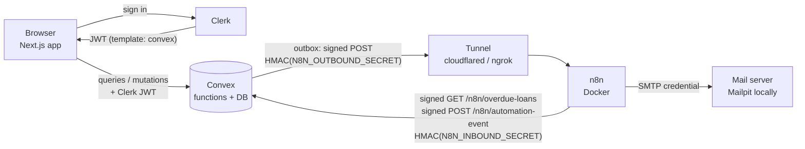
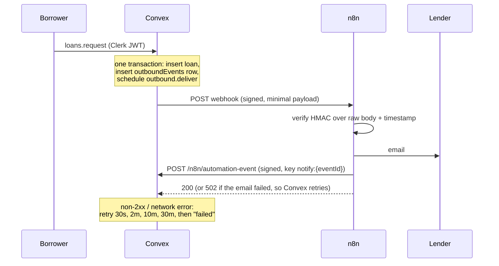

# LendLoop

**Borrow what you need. Lend what you don't.**

LendLoop is a neighbourhood tool-lending board. Neighbours list tools, ask to borrow them for a date range, owners approve or decline, and loans get marked as returned. n8n sends the notification emails and a daily overdue reminder, and writes what it did back to Convex so each loan shows its automation history ("Lender notified 5 minutes ago").

**Stack:** Next.js 15 (App Router, TypeScript strict) · Clerk · Convex · n8n (Docker) · Tailwind CSS v4 · Vitest + convex-test

| Page | Who | What |
|---|---|---|
| `/` | anyone | Tagline and a read-only list of available tools (name + category only) |
| `/tools` | signed in | All listings, category filter, availability, Trusted Lender badge, request with a date range |
| `/my-listings` | signed in | Create, edit and delete your tools |
| `/my-requests` | signed in | Your requests with status and automation activity; cancel pending ones |
| `/incoming` | signed in | Requests on your tools: approve, decline, mark returned |
| `/admin` | admins | All loans, remove listings, toggle Trusted Lender, retry failed notifications |

> **Screenshots:** add them to `docs/screenshots/` after the first run (landing, `/tools`, `/incoming` with activity, `/admin`).

---

## Contents

1. [Architecture](#architecture)
2. [Local setup](#local-setup)
3. [Environment variables](#environment-variables)
4. [Security decisions](#security-decisions)
5. [Data minimisation](#data-minimisation)
6. [Reliability](#reliability)
7. [Tests](#tests)
8. [Design notes and trade-offs](#design-notes-and-trade-offs)
9. [What I'd change for production](#what-id-change-for-production)
10. [Repository layout](#repository-layout)

---

## Architecture



**Request notification (workflow 1)**



**Overdue reminders (workflow 2):** daily at 08:00 n8n signs a `GET /n8n/overdue-loans`, Convex returns approved loans past their end date (minimal fields, plus `remindedToday` and the idempotency key `overdue:{loanId}:{YYYY-MM-DD}`), n8n emails each borrower not yet reminded today, then writes back `sent` or `failed`.

---

## Local setup

Prerequisites: Node 20+, Docker Desktop, a free [Clerk](https://clerk.com) account, a free [Convex](https://convex.dev) account, and [`cloudflared`](https://developers.cloudflare.com/cloudflare-one/connections/connect-networks/downloads/) (or ngrok).

### 1. Install

```bash
git clone <this repo> lendloop && cd lendloop
npm install
```

### 2. Clerk

1. Create a Clerk application (email sign-in is enough).
2. **Configure → JWT templates → New template → Convex.** Keep the name `convex`. LendLoop reads the `name` and `email` claims (email is only used to send notifications). If the template's claims don't already include them, add:
   ```json
   { "name": "{{user.full_name}}", "email": "{{user.primary_email_address}}" }
   ```
3. Copy the template's **Issuer** URL (e.g. `https://your-app.clerk.accounts.dev`).
4. From **API keys**, copy the publishable and secret keys.

### 3. Convex

```bash
npx convex dev
```

This logs you in, creates a dev deployment, writes `CONVEX_DEPLOYMENT` and `NEXT_PUBLIC_CONVEX_URL` to `.env.local`, and keeps pushing functions as you edit. The first push fails until the Clerk issuer is set. In a second terminal:

```bash
npx convex env set CLERK_JWT_ISSUER_DOMAIN https://your-app.clerk.accounts.dev
```

### 4. Next.js env

Add to `.env.local` (next to what Convex wrote):

```bash
NEXT_PUBLIC_CLERK_PUBLISHABLE_KEY=pk_test_...
CLERK_SECRET_KEY=sk_test_...
NEXT_PUBLIC_CLERK_SIGN_IN_URL=/sign-in
NEXT_PUBLIC_CLERK_SIGN_UP_URL=/sign-up
```

Then `npm run dev` and open http://localhost:3000. Sign up; the app is fully usable now. Notifications sit in the outbox until n8n is connected (steps 5 to 9).

### 5. Generate the shared secrets

```bash
node -e "console.log(require('crypto').randomBytes(32).toString('hex'))"   # run twice
```

One value is the **outbound** secret (Convex signs requests to n8n), the other the **inbound** secret (n8n signs requests to Convex).

### 6. Start the tunnel, then n8n

> ⚠️ **Convex runs in the cloud and cannot reach `localhost:5678`.** n8n's webhook has to be reachable on a public URL. Locally, use a tunnel.

```bash
cloudflared tunnel --url http://localhost:5678
# prints e.g. https://random-words.trycloudflare.com
```

Copy `.env.example` to `.env` and fill in the docker compose section:

```bash
N8N_ENCRYPTION_KEY=<another random hex string>
WEBHOOK_URL=https://random-words.trycloudflare.com
LENDLOOP_OUTBOUND_SECRET=<outbound secret>
LENDLOOP_INBOUND_SECRET=<inbound secret>
LENDLOOP_CONVEX_SITE_URL=https://<your-deployment>.convex.site   # .site, not .cloud
```

```bash
docker compose up -d
```

n8n runs at http://localhost:5678 (create the owner account on first visit) and Mailpit's inbox at http://localhost:8025.

Quick tunnels get a new URL each time they start. When that happens, update `WEBHOOK_URL`, run `docker compose up -d` again, and update `N8N_WEBHOOK_URL` (step 9). A named Cloudflare tunnel or ngrok's reserved domain avoids this. n8n Cloud works too: put the same values in its environment variables.

### 7. Import the workflows

**Fastest (CLI):** imports the Mailpit SMTP credential and all three workflows. The exports already reference that credential (`lendloopSmtp0001`) and set the error workflow (`lendloopErrorWf1`), so 1 and 2 in the list further down are done for you:

```bash
docker compose exec n8n n8n import:credentials --input=/lendloop-n8n/credentials/mailpit-smtp.json
docker compose exec n8n n8n import:workflow --separate --input=/lendloop-n8n/workflows
docker compose restart n8n
```

Then activate the two main workflows in the UI (step 3 below).

**Or by hand:** in n8n, **Workflows → Import from file**, once for each file in `n8n/workflows/`:

| File | Workflow |
|---|---|
| `error-handler.json` | LendLoop – Error handler (import first) |
| `request-notification.json` | LendLoop – Request notification |
| `overdue-reminders.json` | LendLoop – Overdue reminders |

Then:

1. **Create the SMTP credential.** Open any email node, choose **Credential → Create new → SMTP**, name it `LendLoop SMTP`. For Mailpit: host `mailpit`, port `1025`, SSL/TLS off, user and password empty. Select it on every email node: *Email lender*, *Email borrower*, *Email reminder*, *Alert admin*. Credentials are stored encrypted in n8n (with `N8N_ENCRYPTION_KEY`), never in the workflow JSON.
2. **Set the error workflow.** In each of the two main workflows: **⋯ → Settings → Error workflow → LendLoop – Error handler**. Save.
3. **Activate** both main workflows (toggle at the top right). The error handler doesn't need activating.

### 8. Point Convex at n8n

```bash
npx convex env set N8N_WEBHOOK_URL https://random-words.trycloudflare.com/webhook/lendloop-loan-event
npx convex env set N8N_OUTBOUND_SECRET <outbound secret>
npx convex env set N8N_INBOUND_SECRET <inbound secret>
```

### 9. Try it

1. In one browser, sign up as a lender and list a tool. In a private window, sign up as a borrower and request it.
2. Mailpit shows the lender's email; `/my-requests` shows "Lender notified · just now".
3. To test overdue reminders, approve a loan, then in the Convex dashboard change its `endDate` to a past date and run *Overdue reminders* manually (**Execute workflow**). Run it again: no second email, because `remindedToday` is now true.
4. To test retries, run `docker compose stop n8n`, make a request, and watch the `outboundEvents` row in the Convex dashboard: `attempts` climbs, then the status becomes `failed` (about 42 minutes in total). `/admin` lists it with a **Retry** button.

### 10. Promote an admin

Roles can only be changed by an internal mutation, from the CLI or the Convex dashboard (Functions → `users:setRole`). The user must have signed in once.

```bash
npx convex run users:setRole '{"email":"you@example.com","role":"admin"}'
```

Refresh the app and **Admin** appears in the nav.

---

## Environment variables

| Variable | Set where | Purpose |
|---|---|---|
| `CONVEX_DEPLOYMENT` | `.env.local` (written by `npx convex dev`) | Which Convex deployment the CLI pushes to |
| `NEXT_PUBLIC_CONVEX_URL` | `.env.local` (written by `npx convex dev`) | Convex client URL for the browser |
| `NEXT_PUBLIC_CLERK_PUBLISHABLE_KEY` | `.env.local` | Clerk frontend key |
| `CLERK_SECRET_KEY` | `.env.local` | Clerk server key (middleware) |
| `NEXT_PUBLIC_CLERK_SIGN_IN_URL` / `_SIGN_UP_URL` | `.env.local` | Routes for Clerk's hosted components |
| `CLERK_JWT_ISSUER_DOMAIN` | Convex env | Issuer Convex trusts for Clerk JWTs (`auth.config.ts`) |
| `N8N_WEBHOOK_URL` | Convex env | n8n request-notification webhook (tunnel URL + `/webhook/lendloop-loan-event`) |
| `N8N_OUTBOUND_SECRET` | Convex env | HMAC key for Convex → n8n |
| `N8N_INBOUND_SECRET` | Convex env | HMAC key for n8n → Convex |
| `N8N_ENCRYPTION_KEY` | `.env` (compose) | Encrypts n8n credentials at rest. Keep it stable or stored credentials become unreadable |
| `WEBHOOK_URL` | `.env` (compose) | Public base URL n8n uses for webhooks (the tunnel) |
| `GENERIC_TIMEZONE` | `.env` (compose) | Time zone for the 08:00 schedule |
| `LENDLOOP_OUTBOUND_SECRET` | `.env` (compose) | Same value as `N8N_OUTBOUND_SECRET`; n8n verifies with it |
| `LENDLOOP_INBOUND_SECRET` | `.env` (compose) | Same value as `N8N_INBOUND_SECRET`; n8n signs with it |
| `LENDLOOP_CONVEX_SITE_URL` | `.env` (compose) | Convex HTTP actions base URL (`*.convex.site`) |
| `LENDLOOP_APP_URL` | `.env` (compose) | Link included in emails |
| `LENDLOOP_FROM_EMAIL` / `LENDLOOP_ALERT_EMAIL` | `.env` (compose) | Sender address, and the recipient of error alerts |

`N8N_BLOCK_ENV_ACCESS_IN_NODE=false` and `NODE_FUNCTION_ALLOW_BUILTIN=crypto` are fixed in `docker-compose.yml`. n8n 2.x blocks `$env` in nodes by default. Allowing it lets the workflows read the secrets as `{{ $env.LENDLOOP_* }}`, so the exported JSON only ever holds the expression. The Code nodes need `crypto` for HMAC and `timingSafeEqual`. The cost: anyone who can edit workflows on this n8n instance can read its environment, so editor access must be limited to trusted people (see production notes).

---

## Security decisions

**Authorization is enforced in Convex, on every call.**
- Every public query and mutation begins with `requireUser` or `requireAdmin` (`convex/lib/auth.ts`); the only exception is `tools.publicList`. Ownership checks (`assertToolOwner`, `assertLoanParty`) run before any data is read or written. The UI hides buttons for convenience, but the server is the control. A test calls every protected function anonymously and expects `UNAUTHENTICATED`.
- `middleware.ts` (Clerk) only guards navigation. The `/admin` page renders nothing useful for non-admins, but its real protection is that every `admin.*` function calls `requireAdmin`.
- A valid Clerk token alone isn't enough: the caller also needs a stored user row (created by `users.store` from the verified JWT claims).

**Roles can never be set by the client.** `users.store` takes no arguments and never touches `role` or `trustedLender`. Roles change only through the internal mutation `users.setRole`, which only the CLI or dashboard can run. Trust changes only through admin mutations.

**Business rules live on the server.** Users can't borrow their own tool. Dates must be real, start today or later, end on or after the start, span at most 30 days and start within a year. Overlaps with approved loans are rejected both when requesting and again when approving. Status changes go through one `transition()` function backed by an explicit table (`pending → approved | declined | cancelled`, `approved → returned`). All arguments use Convex `v` validators, and text is trimmed, length-checked and stripped of control characters. `ownerId`, `status` and `lenderId` are always derived on the server, never accepted from the client.

**Generic errors.** Functions throw `ConvexError({ code, message })` with short, safe messages (`convex/lib/errors.ts`). `FORBIDDEN` reads the same whether or not the record exists. HTTP endpoints return a bare `401 {"error":"unauthorized"}` or `400 {"error":"invalid request"}` with no detail.

**Webhook signing in both directions** (`convex/lib/hmac.ts`, and the Code nodes in n8n):
- `X-LendLoop-Signature = hex(HMAC_SHA256(secret, timestamp + "." + rawBody))`, `X-LendLoop-Timestamp` (unix seconds), `X-LendLoop-Event-Id`.
- The receiver recomputes the HMAC over the **raw** body (n8n's webhook has *Raw Body* on), compares in constant time (`timingSafeEqual`), and rejects timestamps more than 5 minutes off in either direction (replay protection). A missing secret fails closed.
- Separate secrets per direction, so a leaked n8n-side key can't forge Convex's outbound events, and the reverse.
- n8n write-backs are also checked semantically: a `notify:{eventId}` key must match a real outbox event for that loan, and an `overdue:{loanId}:{date}` key must name the loan in the body.
- Request bodies are capped at 8 KB.

**Secrets live only in env vars and credentials.** Convex secrets are set with `npx convex env set`. n8n reads them from container env through expressions, and SMTP sits in an encrypted n8n credential. `.env*` is git-ignored except `.env.example`, and CI greps the workflow exports for secret literals.

**Soft deletes.** Removing a tool sets `removedAt` and `removedBy` instead of deleting it, so loan history and the admin audit trail survive. An admin removal declines that tool's pending requests (and the borrowers are told). Approved loans stay open, because the tool still has to come back.

**Headers.** `next.config.ts` sets `X-Frame-Options: DENY`, `nosniff`, a strict referrer policy and a minimal permissions policy, and turns off `X-Powered-By`.

---

## Data minimisation

- **Public page:** `tools.publicList` returns `{ name, category }` and nothing else: no ids, owners, descriptions or dates. A test asserts the exact keys.
- **Signed-in pages** see owner *names* and the Trusted Lender flag, never other users' emails or Clerk ids. Only admins see emails, so they can identify accounts. `tokenIdentifier` never leaves the server.
- **Webhook payload to n8n** is exactly `eventId, type, loanId, newStatus, recipientEmail, recipientName, toolName, startDate, endDate`. It only names the one person being emailed, and has no description and no Clerk ids. The schema's `vOutboundPayload` validator and a test enforce this.
- **Overdue endpoint** returns the same minimal fields for each overdue loan.
- **No PII in logs.** Convex logs event ids and HTTP status codes only. Outbox `lastError` stores `HTTP 503` or `Network error (TypeError)`, never response bodies (which could echo the payload) or exception messages (which can contain URLs). The n8n error workflow logs workflow name, execution id, failed node and message, with email addresses redacted.

---

## Reliability

- **Transactional outbox.** The mutation that changes a loan also inserts an `outboundEvents` row and schedules `internal.outbound.deliver` with `ctx.scheduler.runAfter(0, …)`. Convex commits all three atomically, so an event is never lost and never sent for a change that rolled back.
- **Retries with backoff.** `deliver` signs and POSTs with a 10 s timeout. On a non-2xx response or network error, `recordFailure` increments `attempts` and reschedules after 30 s, 2 min, 10 min, then 30 min. The fifth failure marks the event `failed`. Admins see stuck and failed events in `/admin` and can re-queue them.
- **n8n retries.** Every HTTP Request and email node has *Retry On Fail* (3 tries, 5 s apart).
- **Email failure isn't silent.** Email nodes use the error output: the workflow records `failed` in Convex, then answers the webhook with `502`, so Convex's outbox retries the whole notification later.
- **Error workflow.** Both workflows point at *LendLoop – Error handler*. It logs a PII-free summary to the container log and emails `LENDLOOP_ALERT_EMAIL`. If the alert email itself fails, the log line is still there.
- **Idempotent write-backs.** `automationEvents.idempotencyKey` is looked up through the `by_key` index before inserting. Convex mutations are serializable, so two concurrent write-backs with the same key can't both insert: the loser retries and sees the row. A repeated key returns `200 {"result":"duplicate"}`. A `failed` row can later be upgraded to `sent`, while `sent` is final.
- **No duplicate reminders.** The overdue feed includes `remindedToday`, and the workflow skips loans already reminded, so re-running the workflow on the same day sends nothing twice.
- **At-least-once, stated plainly.** If n8n sends the email but its 200 never reaches Convex, Convex retries and the email can go out twice; the write-back still records one event. Fixing that needs n8n to dedupe on `X-LendLoop-Event-Id` before sending (noted below).

---

## Tests

```bash
npm test          # vitest + convex-test, no network or Convex account needed
npm run typecheck # app and convex/ (both strict)
npm run lint
```

53 tests in `convex/tests/`:

| File | Covers |
|---|---|
| `authorization.test.ts` | Every protected function rejects anonymous callers; a token without a stored user is rejected; A can't edit, delete, approve, decline or return on B's tool; only the borrower cancels; no deleting tools with open loans; non-admins can't call any admin function; `users.store` can't set a role |
| `loans.test.ts` | Can't borrow your own tool; past, reversed, over-30-day, invalid and too-far-ahead dates rejected; overlapping ranges rejected (edges included) at request and at approval; every invalid transition rejected; tool availability follows approve and return; one outbox event per change, with the right recipient |
| `public.test.ts` | Public query returns only `name` and `category`, only for available, non-removed tools |
| `hmac.test.ts` | Matches a Node `crypto` reference value; valid accepted; tampered body, wrong secret, stale or future timestamp, changed timestamp and missing headers rejected |
| `http.test.ts` | Signed HTTP routes: 401 on bad, missing or stale signatures and on an unset secret; same idempotency key twice → one record; failed → sent upgrade; notify keys must match a real outbox event; malformed bodies → 400 |
| `outbound.test.ts` | Delivery sends a verifiable signature and exactly the minimal payload; 5 failed attempts → `failed`; recovers mid-retry; admin re-queue (and non-admins can't) |
| `validation.test.ts` | Date helpers, inclusive overlap, the transition table |

---

## Design notes and trade-offs

- **Availability vs. booking.** `tool.status` is `on_loan` while the tool has any approved loan, and returns to `available` when the last one is returned. Requests are allowed for any listed tool on dates that don't clash with an approved loan, so a drill that's out this week can still be booked for next week. The tool cards show booked ranges. This is what makes the "reject overlaps with approved loans" rule meaningful; with a strict "only when available" rule the overlap check could never trigger.
- **Dates are UTC calendar days.** "Today", past-date checks and "overdue" all use UTC. A neighbour in UTC+10 at 08:00 local is still on "yesterday". Production would store a time zone per neighbourhood (below).
- **Pending requests that clash** are allowed until one is approved; approving re-checks overlaps, so the second approval fails with a clear message instead of double-booking.
- **Lists are capped at 200 rows** (`LIMITS.listPage`). Real pagination (`paginate()`) is a straightforward follow-up.
- **The GET signature covers `timestamp + "."`** (empty body), as specified. It proves who sent it and when, but doesn't bind the method or path. That's fine for a single read-only endpoint, but a canonical string that includes method and path is better (below).

---

## What I'd change for production

- **Secret rotation:** add a key id header (`X-LendLoop-Key-Id`) and accept the current and previous key during a rotation window. Include method and path in the signed string.
- **Managed secrets:** keep secrets in a secrets manager (Doppler, Vault, AWS/GCP Secret Manager) instead of `.env`, and use n8n's external secrets feature so even `$env` access isn't needed.
- **Rate limiting** on the HTTP endpoints and on mutations (per user, e.g. with `@convex-dev/rate-limiter`), plus request quotas per neighbour.
- **Queue-backed n8n:** queue mode with Redis and Postgres instead of SQLite, several workers, and dedupe on `X-LendLoop-Event-Id` before sending email (exactly-once in practice).
- **Structured logging and monitoring:** JSON logs with correlation ids (`eventId`) across Convex and n8n, Sentry or Datadog, and alerts on `failed` outbox rows and error-workflow runs.
- **Audit log table** for admin actions (who removed which listing, who changed trust or roles, when, and why).
- **Email provider** (Postmark, SES, Resend) with bounce and complaint webhooks, unsubscribe handling and templates.
- **Time-zone-aware dates:** a neighbourhood or user time zone, overdue computed in local time, and reminders sent at local 08:00.
- **CI and CD:** this repo's CI runs typecheck, lint, tests and a secrets grep. Add Playwright end-to-end tests, `convex deploy` from CI and dependency scanning.
- **Network hardening:** run n8n behind SSO or a VPN with only `/webhook/*` public (Cloudflare Access or a reverse proxy rule), lock down `$env` access, and restrict who can edit workflows.
- **Backups:** Convex snapshot exports on a schedule, n8n database and encryption key backups, and a tested restore.
- **Abuse and trust:** verified neighbourhood membership, reporting listings, and limits on concurrent requests.

---

## Repository layout

```
app/                     Next.js routes
  page.tsx               public landing (publicList)
  (app)/                 signed-in pages: tools, my-listings, my-requests, incoming, admin
  sign-in/, sign-up/     Clerk components
components/              AppShell (nav + user bootstrap), cards, forms, status pills, UI primitives
lib/                     client helpers: error messages + toasts, date formatting
middleware.ts            Clerk route protection (navigation only)
convex/
  schema.ts              tables, indexes and shared validators
  auth.config.ts         Clerk issuer
  users.ts               store, me, setRole (internal)
  tools.ts               publicList, list, mine, create, update, remove
  loans.ts               request, approve, decline, cancel, markReturned, myRequests, incoming
  admin.ts               all loans, tools and users, removeTool, setTrustedLender, retryOutbound
  outbound.ts            outbox delivery + retries (internal)
  automation.ts          overdue feed + idempotent write-back (internal)
  http.ts                signed n8n endpoints
  lib/                   auth, hmac, validation, errors, outbox, activity, tools, constants
  tests/                 convex-test + Vitest suites
n8n/workflows/           request-notification, overdue-reminders, error-handler (no secrets)
docker-compose.yml       n8n + Mailpit
.env.example             every variable, no values
```
